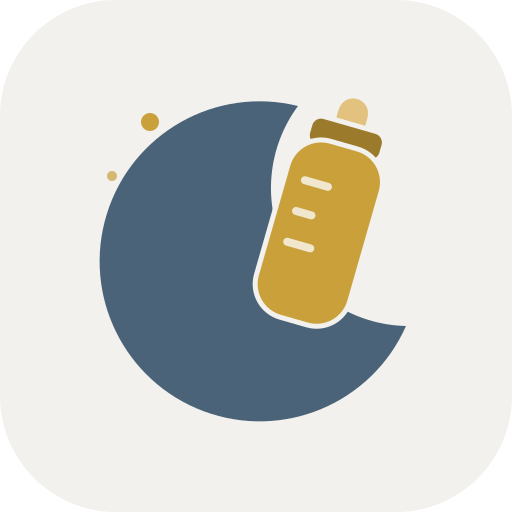

<p align="center"></p>

# BabyEs

A local sleep and bottle diary for Home Assistant, with a dashboard card.
English and Norwegian (bokmål). [Norsk nedenfor](#norsk).

- Start and stop sleep, register bottles (breast milk and formula), edit and delete entries. Tap an amount to type it, and change the start of a sleep you started late straight from the message after **Start sleep**.
- The card shows how long the baby has slept or been awake, today's sleep and bottles, and an optional 24-hour timeline of sleep and bottles ("Show timeline").
- History with a 24-hour dial, week overview and 7-day charts.
- Follows your Home Assistant profile: language, 12/24-hour clock, and the colours of your theme (light and dark).
- Entities and services for automations.
- Everything is stored locally in Home Assistant (`/config/.storage/babyes.diary`) and included in backups. Nothing is sent anywhere.

## Install

1. In HACS, open **⋮ → Custom repositories**, add `https://github.com/sonkarlsen/BabyEs` with type **Integration**.
2. Install **BabyEs** and restart Home Assistant.
3. Go to **Settings → Devices & services → Add integration → BabyEs**. Enter a name (shown on the card).

The dashboard card is served by the integration, so no dashboard resource is needed. Add it to a dashboard:

```yaml
type: custom:babyes-card
step: 5        # ml per tap (optional)
name: Baby     # optional, overrides the name from the integration
```

Updates show up in HACS. Updates that only change the card take effect when you reload the dashboard. Updates that change the integration need a restart of Home Assistant; the [changelog](CHANGELOG.md) says which.

## Entities

| Entity | Description |
|---|---|
| `binary_sensor.<name>_sleeping` | On while asleep |
| Sleep today / this week | Minutes |
| Asleep for / awake for | Minutes, current period |
| Last bottle | Time of the last bottle, amounts as attributes |
| Bottles today / this week | ml, plus breast milk and formula today |
| Number of bottles today / this week | Count |

Entity ids depend on the name you choose and your language.

## Services

- `babyes.start_sleep` (optional `start`)
- `babyes.stop_sleep`
- `babyes.add_feed` (`breast_milk_ml`, `formula_ml`, optional `timestamp`, `note`)

## Theming, language and clock

The card uses the colours of your active Home Assistant theme, in light and dark mode: card background, text and dividers from the theme, sleep in the theme's `primary-color` and bottles in its `accent-color`. If those two look too similar, bottles use another colour from the theme that stands out from the sleep colour. Formula gets a third theme colour that differs from both, so breast milk and formula are easy to tell apart. To give BabyEs its own colours, add any of these variables to your theme: `babyes-sleep-color`, `babyes-feed-color`, `babyes-milk-color`, `babyes-formula-color`, `babyes-card-color`.

The language follows the language in your Home Assistant profile (Norwegian or English; other languages use English) and changes as soon as you switch it. Times follow the **Time format** in your profile (12 or 24 hours), like the rest of Home Assistant.

Animations respect the "reduce motion" setting of your device.

---

## Norsk

En lokal dagbok for søvn og flasker i Home Assistant, med eget dashbordkort.

- Start og stopp søvn, registrer flasker (brystmelk og MME), rediger og slett. Trykk på en mengde for å skrive den inn, og endre starttiden på en søvn du startet for sent rett fra meldingen etter **Start søvn**.
- Kortet viser hvor lenge babyen har sovet eller vært våken, dagens søvn og flasker, og en tidslinje for døgnet som du kan vise eller skjule («Vis tidslinje»).
- Historikk med døgnur, ukeoversikt og grafer for de siste 7 dagene.
- Følger profilen din i Home Assistant: språk, 12/24-timersklokke og fargene i temaet ditt (lyst og mørkt).
- Entiteter og tjenester til automasjoner.
- Alt lagres lokalt i Home Assistant (`/config/.storage/babyes.diary`) og er med i sikkerhetskopiene. Ingenting sendes noe sted.

### Installering

1. I HACS: **⋮ → Egendefinerte repositorier**, legg til `https://github.com/sonkarlsen/BabyEs` med type **Integrasjon**.
2. Installer **BabyEs** og start Home Assistant på nytt.
3. Gå til **Innstillinger → Enheter og tjenester → Legg til integrasjon → BabyEs**. Skriv inn et navn (vises på kortet).

Kortet leveres av integrasjonen, så du trenger ikke legge til en ressurs. Legg det i dashbordet:

```yaml
type: custom:babyes-card
step: 5
```

Oppdateringer vises i HACS. Oppdateringer som bare endrer kortet, får du ved å laste dashbordet på nytt. Oppdateringer som endrer integrasjonen, krever omstart av Home Assistant; [endringsloggen](CHANGELOG.md) sier hvilke.

### Tema, språk og klokke

Kortet bruker fargene i temaet du har valgt i Home Assistant: søvn i temaets `primary-color` og flasker i `accent-color`. Er de to for like, får flaskene en annen farge fra temaet som skiller seg tydelig fra søvnfargen. MME får en tredje farge fra temaet som skiller seg fra begge, så brystmelk og MME er lette å skille. Vil du ha egne farger, kan du legge til `babyes-sleep-color`, `babyes-feed-color`, `babyes-milk-color`, `babyes-formula-color` eller `babyes-card-color` i temaet.

Språket følger profilen din og byttes med en gang du endrer det. Klokkeslett følger **Tidsformat** i profilen (12 eller 24 timer), som resten av Home Assistant.
